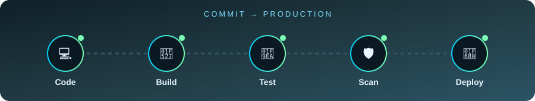
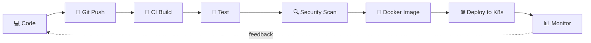

<!-- ===================== HEADER ===================== -->
<div align="center">


<a href="https://github.com/iamohsin1273">
  
</a>

<br/>


<a href="https://github.com/iamohsin1273?tab=followers"></a>


<br/><br/>

<a href="https://iamohsin1273.github.io/portfolio/"></a>
<a href="https://Linkedin.com/in/iam-mohsin"></a>
<a href="https://x.com/_iamohsin_"></a>
<a href="https://www.instagram.com/_iamohsin_"></a>

</div>

<br/>

<!-- ===================== ANIMATED PIPELINE ===================== -->
<div align="center">
  
</div>

---

## 👋 About Me

```yaml
name:      Mohamed Mohsin
role:      DevOps Engineer
location:  Chennai, India
focus:     [CI/CD, Infrastructure as Code, Containers, Cloud]
learning:  [Advanced Kubernetes, Observability, GitOps]
currently: Building production-style CI/CD and cloud projects
ask_me_about: [AWS, Docker, Kubernetes, Terraform, Linux, Jenkins]
```

- 🔭 I build **automated pipelines** that take code from commit to production
- ☁️ I design and deploy infrastructure on **AWS** using **Terraform**
- 🐳 I containerize apps with **Docker** and orchestrate them on **Kubernetes**
- 📈 I'm always exploring **monitoring, security and GitOps** practices
- 🤝 Open to collaborating on DevOps and cloud projects

---

## 🛠️ Tech Stack

<div align="center">

**Cloud, Containers & Infrastructure**


**CI/CD & Version Control**


**Backend & Data**


**Frontend**


</div>

---

## 📊 GitHub Stats

<div align="center">

<a href="https://github.com/iamohsin1273">
  
</a>
<a href="https://github.com/iamohsin1273">
  
</a>

<br/>


<br/><br/>


</div>

---

## 📈 Contribution Activity

<div align="center">
  
</div>

---

## 🚀 Featured Projects

<div align="center">

<table>
  <tr>
    <td width="50%" valign="top">
      <h3>🛒 <a href="https://github.com/iamohsin1273/quickora-commerce">QUICKORA Commerce</a></h3>
      <p>Quick-commerce platform for Chennai built as a TypeScript monorepo: React storefront, Express API, PostgreSQL via Prisma, admin and delivery roles, JWT cookie auth, Docker Compose.</p>
      
      
      
      
    </td>
    <td width="50%" valign="top">
      <h3>🐍 <a href="https://github.com/iamohsin1273/django-api">Django API on AWS EKS</a></h3>
      <p>Production-grade REST API with JWT auth, Celery, Postgres and Redis. Ships with Terraform for VPC, EKS, RDS, ElastiCache and ECR, Kustomize manifests and a Jenkins pipeline.</p>
      
      
      
      
    </td>
  </tr>
  <tr>
    <td width="50%" valign="top">
      <h3>🔐 <a href="https://github.com/iamohsin1273/ai-devsecops-demo">DevSecOps Pipeline Demo</a></h3>
      <p>Spring Boot REST API with a full DevSecOps flow: Maven, SonarQube quality gate, multi-stage non-root Docker image, Jenkins pipeline and Kubernetes deployment.</p>
      
      
      
      
    </td>
    <td width="50%" valign="top">
      <h3>⚙️ <a href="https://github.com/iamohsin1273/github-actions-k8s-cicd">GitHub Actions → Kubernetes CI/CD</a></h3>
      <p>Tests an Express app, publishes the image to GHCR and rolls it out to Kubernetes with automatic rollback, all driven by GitHub Actions.</p>
      
      
      
    </td>
  </tr>
  <tr>
    <td width="50%" valign="top">
      <h3>🌐 <a href="https://iamohsin1273.github.io/portfolio/">Animated Portfolio</a> · <a href="https://github.com/iamohsin1273/portfolio">source</a></h3>
      <p>Fast single-page portfolio with a hero terminal, GSAP scroll animation, tilt effects and a pipeline showcase. Pure HTML, CSS and JS, auto-deployed to GitHub Pages.</p>
      
      
      
    </td>
    <td width="50%" valign="top">
      <h3>🐳 <a href="https://github.com/iamohsin1273/flask-docker-app">Flask + Docker + Nginx</a></h3>
      <p>Multi-stage Flask image served by Gunicorn behind Nginx with a PostgreSQL backend, run with Docker Compose and deployed by a Jenkins pipeline.</p>
      
      
      
      
    </td>
  </tr>
</table>

<sub>More on my <a href="https://github.com/iamohsin1273?tab=repositories">repositories page</a>.</sub>

</div>

---

## 🗺️ Currently Exploring

| Area | Focus |
|------|-------|
| ☸️ **Kubernetes** | Helm, ingress, autoscaling, cluster ops |
| 🏗️ **Terraform** | Modules, remote state, multi-environment setups |
| 🔐 **DevSecOps** | Image scanning, secrets management, policy as code |
| 📡 **Observability** | Prometheus, Grafana, alerting |

<details>
<summary><b>🎯 Click to see my DevOps workflow</b></summary>

<br/>



</details>

---

## 🐍 Contribution Snake

<div align="center">
  <picture>
    <source media="(prefers-color-scheme: dark)" srcset="https://raw.githubusercontent.com/iamohsin1273/iamohsin1273/output/github-snake-dark.svg"/>
    <source media="(prefers-color-scheme: light)" srcset="https://raw.githubusercontent.com/iamohsin1273/iamohsin1273/output/github-snake.svg"/>
    
  </picture>
</div>

---

## 📫 Let's Connect

<div align="center">

<a href="https://Linkedin.com/in/iam-mohsin"></a>
<a href="https://iamohsin1273.github.io/portfolio/"></a>

<br/><br/>

*"Automate everything. Break nothing. Ship often."* ⚡

<br/>


</div>
