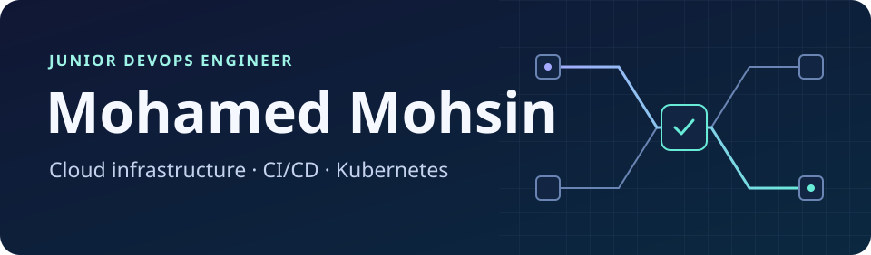

[**Projects**](#featured-projects) · [**Toolkit**](#technical-toolkit) · [**Activity**](#github-activity) · [**Connect**](#connect)

I’m Mohamed Mohsin, a junior DevOps engineer based in **Chennai, India**, with a **B.Tech in Computer Science and Engineering**. I build and document delivery workflows for containerized applications, from automated tests and security scans to AWS infrastructure and Kubernetes deployment.

## Featured projects

### Quickora Commerce

**TypeScript · React · Express · PostgreSQL · Docker Compose · AWS · Argo CD**

A Chennai quick-commerce app with a customer storefront, admin dashboard, and rider workflows. At checkout, the API validates the order and updates inventory in the same database transaction.

<strong>Trace an order and explore the deployment</strong>

1. Start the storefront, API, and PostgreSQL with Docker Compose. Place a demo order and find it in the admin dashboard.
2. Review the GitHub Actions workflow that runs integration tests against PostgreSQL.
3. Render the Kubernetes manifests to inspect the API and web deployments, health probes, and Prisma migration job. The Argo CD template runs that job before rollout.

The ECS Fargate Terraform is available in the repo. The EKS track includes manifests and digest-pinned release templates. Cluster provisioning and monitoring are planned.

[Repository](https://github.com/iamohsin1273/quickora-commerce) · [Architecture and walkthrough](https://github.com/iamohsin1273/quickora-commerce#architecture) · [ECS guide](https://github.com/iamohsin1273/quickora-commerce/blob/main/docs/DEPLOYMENT.md) · [EKS runbook](https://github.com/iamohsin1273/quickora-commerce/blob/main/docs/EKS.md)

### AI-Assisted DevSecOps Pipeline

**Spring Boot · Jenkins · Maven · SonarQube · Trivy · Kubernetes**

A Jenkins pipeline definition for building, scanning, publishing, and deploying a Spring Boot API, followed by cluster diagnostics and notifications.

```mermaid
flowchart LR
    Build["Maven build and tests"] --> Quality["SonarQube quality gate"]
    Quality --> Scan["Trivy filesystem scan"]
    Scan --> Image["Build Docker image"]
    Image --> ImageScan["Trivy image scan"]
    ImageScan --> Publish["Publish image"]
    Publish --> Deploy["Deploy to Kubernetes"]
    Deploy --> Diagnose["K8sGPT and Gemini analysis"]
    Diagnose --> Notify["Slack notification"]
```

<strong>Follow the pipeline from build to diagnosis</strong>

A full run requires Jenkins, the pipeline tools, registry access, credentials, and a Kubernetes cluster. Trivy stages can be skipped through a pipeline parameter.

[Repository](https://github.com/iamohsin1273/ai-devsecops-demo) · [Jenkinsfile](https://github.com/iamohsin1273/ai-devsecops-demo/blob/main/Jenkinsfile)

### Django API on AWS EKS

**Python · Django REST Framework · Terraform · Kubernetes · Kustomize · Jenkins**

A Django REST API with AWS infrastructure and Kubernetes deployment configuration.

<strong>Explore the infrastructure and delivery setup</strong>

Review how the repository organizes Terraform for AWS infrastructure, Kubernetes manifests with Kustomize, and the Jenkins pipeline. The source repository documents the setup and prerequisites.

[Repository and setup guide](https://github.com/iamohsin1273/django-api)

### GitHub Actions to Kubernetes

**Express · GitHub Actions · GHCR · Kubernetes**

An Express project with automated tests, container publishing, and a Kubernetes rollout check with automatic rollback.

<strong>See how the workflow handles a failed rollout</strong>

The workflow builds and publishes the container to GitHub Container Registry, updates Kubernetes, and checks rollout status. If the rollout fails, it attempts a rollback. Deployment requires cluster access and configured secrets.

[Repository](https://github.com/iamohsin1273/github-actions-k8s-cicd) · [Workflow files](https://github.com/iamohsin1273/github-actions-k8s-cicd/tree/main/.github/workflows)

### Zomato Clone Deployment Practice

**Docker · Jenkins · Kubernetes**

A deployment practice repository with a Dockerfile, Jenkins pipeline, and Kubernetes Deployment and Service manifests.

<strong>Compare the container and Kubernetes paths</strong>

The Jenkinsfile checks out an upstream application and runs the built container directly. The Kubernetes manifests describe a separate deployment path.

[Repository](https://github.com/iamohsin1273/DevOps-Project-Zomato)

## Technical toolkit

| Area | Tools |
| --- | --- |
| Cloud and infrastructure | AWS, Terraform, Linux |
| Containers and orchestration | Docker, Kubernetes, Kustomize |
| CI/CD and source control | Jenkins, GitHub Actions, Git, Maven |
| Security and diagnostics | SonarQube, Trivy, K8sGPT |
| Languages and data | Java, Python, TypeScript, JavaScript, Bash, PostgreSQL |
| Currently exploring | Argo CD, GitOps, Prometheus, Grafana |

## GitHub activity

<strong>Show contribution animation</strong>

<picture>
  <source media="(prefers-color-scheme: dark)" srcset="https://raw.githubusercontent.com/iamohsin1273/iamohsin1273/output/github-snake-dark.svg">
  
</picture>

[GitHub activity](https://github.com/iamohsin1273) · [All repositories](https://github.com/iamohsin1273?tab=repositories)

## Connect

[Portfolio](https://iamohsin1273.github.io/portfolio/) · [LinkedIn](https://www.linkedin.com/in/iam-mohsin)
