 

  

## About

I’m an early-career DevOps engineer with a **B.Tech in Computer Science and Engineering**. My project work brings together AWS infrastructure-as-code, containerized applications, CI/CD automation, and Kubernetes deployment patterns.

I’ve built with **Docker, Kubernetes, Jenkins, GitHub Actions, Terraform, and Linux**, and I’m particularly interested in cloud engineering, DevSecOps, observability, and AI-assisted troubleshooting. I aim to make delivery workflows repeatable, secure, and easier to operate.

## Technology

- **Cloud and infrastructure:** AWS · Terraform · Linux · Infrastructure as Code
- **Containers and orchestration:** Docker · Kubernetes · Kustomize
- **CI/CD and source control:** Jenkins · GitHub Actions · Git · Maven
- **Security and cluster analysis:** SonarQube · Trivy · K8sGPT
- **Programming and application technologies:** Java · Python · TypeScript · JavaScript · Bash · PostgreSQL
- **Currently exploring:** Prometheus · Grafana · GitOps

  

## Featured projects

### [AI-Assisted DevSecOps Pipeline](https://github.com/iamohsin1273/ai-devsecops-demo)

Spring Boot sample API with a Jenkins pipeline definition covering Maven build and tests, a SonarQube quality gate, Trivy filesystem and image scans, Docker image publishing, and Kubernetes deployment. Post-deployment stages add K8sGPT diagnostics, Gemini-assisted analysis, and Slack notifications.

The [Jenkins pipeline](https://github.com/iamohsin1273/ai-devsecops-demo/blob/main/Jenkinsfile) and Kubernetes manifests are in the repository. Running the full workflow requires a configured Jenkins job/trigger, tools, credentials, registry access, and a Kubernetes cluster. Trivy scans can also be skipped through a pipeline parameter.

```mermaid
flowchart LR
    A[Repository change] -. trigger configured separately .-> B[Jenkins pipeline]
    B --> C[Maven build and tests]
    C --> D[SonarQube quality gate]
    D --> E[Trivy filesystem scan]
    E --> F[Build Docker image]
    F --> G[Trivy image scan]
    G --> H[Push to configured registry]
    H --> I[Deploy to Kubernetes]
    I --> J[K8sGPT cluster analysis]
    J --> K[Gemini-assisted analysis]
    K --> L[Slack notification]
```

### [Django API on AWS EKS](https://github.com/iamohsin1273/django-api)

Django REST API project with Terraform for AWS infrastructure, Kubernetes/Kustomize manifests, and a Jenkins pipeline. The repository documents infrastructure and deployment configuration; this profile does not claim that its AWS resources are currently running.

### [QUICKORA Commerce](https://github.com/iamohsin1273/quickora-commerce)

TypeScript monorepo for a Chennai quick-commerce demo, with a React storefront, Express API, PostgreSQL/Prisma, and Docker Compose. Its Terraform documents an AWS architecture using ECS Fargate and related services, but the project README confirms it has **not** been applied and no AWS resources have been created.

See the project's [architecture](https://github.com/iamohsin1273/quickora-commerce/blob/main/docs/ARCHITECTURE.md) and [deployment notes](https://github.com/iamohsin1273/quickora-commerce/blob/main/docs/DEPLOYMENT.md).

### [GitHub Actions to Kubernetes CI/CD](https://github.com/iamohsin1273/github-actions-k8s-cicd)

Express application with CI tests and a container publishing/deployment workflow. The deployment job uses GHCR and Kubernetes and includes a rollout check with automatic rollback; actual cluster deployment requires the repository’s Kubernetes configuration and secrets.

### [Zomato clone deployment practice](https://github.com/iamohsin1273/DevOps-Project-Zomato)

The repository contains a Dockerfile, Jenkins pipeline, and Kubernetes Deployment/Service manifests. Its Jenkinsfile checks out an upstream application repository and its configured deployment stage runs the container directly, so I’m listing this as deployment practice—not as a verified end-to-end Kubernetes rollout.

More projects are available in my [public repositories](https://github.com/iamohsin1273?tab=repositories).

## GitHub activity

## Connect

- **Location:** Chennai, India
- **LinkedIn:** [linkedin.com/in/iam-mohsin](https://www.linkedin.com/in/iam-mohsin)
- **Portfolio:** [iamohsin1273.github.io/portfolio](https://iamohsin1273.github.io/portfolio/)

## Contribution snake

  <picture>
    <source media="(prefers-color-scheme: dark)" srcset="https://raw.githubusercontent.com/iamohsin1273/iamohsin1273/output/github-snake-dark.svg"/>
    <source media="(prefers-color-scheme: light)" srcset="https://raw.githubusercontent.com/iamohsin1273/iamohsin1273/output/github-snake.svg"/>
    
  </picture>

